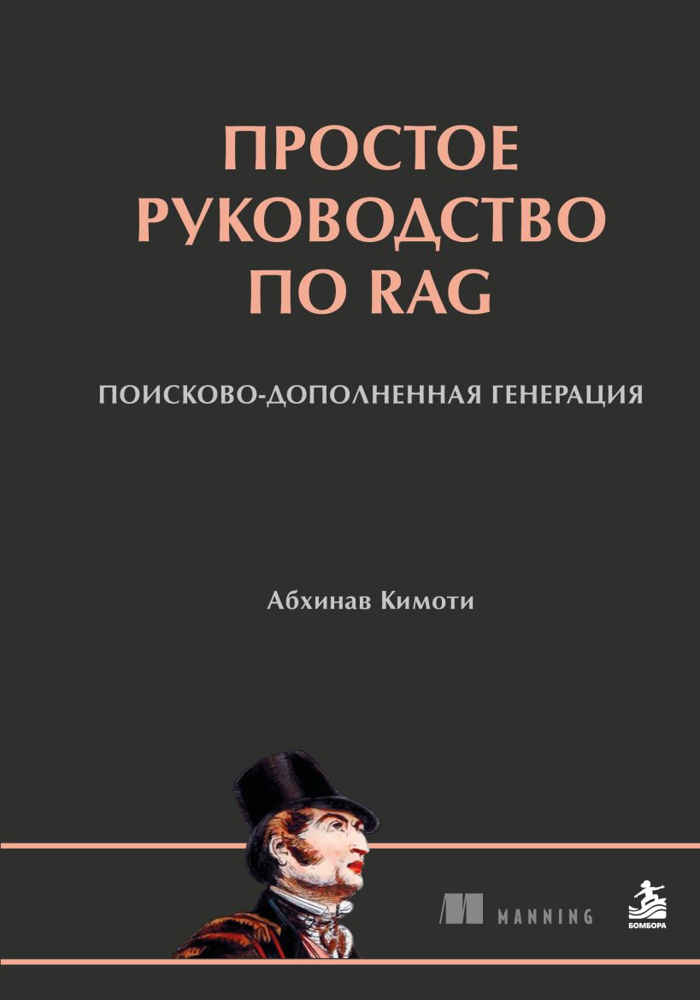

# [Книга][Кимоти Абхинав] Простое руководство по RAG [RUS, 2026]

[Book][Abhinav Kimothi] A Simple Guide to Retrieval Augmented Generation [ENG, 2025]

**Оригинальный репо:**  
https://github.com/abhinav-kimothi/A-Simple-Guide-to-RAG



<br/>

**Простое руководство по дополненной генерации.**

Технология Retrieval Augmented Generation (RAG) позволяет значительно повысить точность и надежность генеративных моделей искусственного интеллекта. Вы получите четкое понимание основ RAG, изучив ключевые компоненты и стратегии построения эффективной системы.

Все про RAG:

* Компоненты системы
* База знаний
* Конвейер индексирования и генерации
* Оценка системы
* Расширенные стратегии
* Инструменты, технологии и фреймворки

Конкретные инструкции по применению концепции RAG в реальных проектах делают книгу незаменимым ресурсом для инженеров, разработчиков и всех желающих освоить современные технологии генеративного искусственного интеллекта. Читатели смогут ознакомиться с множеством примеров кода на Python и приобрести ценные навыки для успешного внедрения RAG-технологий в практику, расширяя профессиональные горизонты.

Книга идеально подходит для самостоятельного освоения материала и может служить справочным пособием для опытных профессионалов. После ее прочтения вы будете готовы внедрять инновационные решения в сфере искусственного интеллекта и развивать карьеру в динамично меняющемся мире AI-технологий.

<br/>

Table of Contents
---

The first three chapters of the book have been released as a part of the Manning Early Access Program. You can [join the MEAP here](https://mng.bz/8wdg)

- Chapter 1 - Large Language Models and the Need for Retrieval Augmented Generation [First draft Released]

- Chapter 2 - RAG-enabled systems and their design [First draft Released]

- Chapter 3 - Indexing Pipeline : Creating a knowledge base for RAG based applications [First draft Released] [Notebook](./Chapters/Chapter-03/indexing_pipeline.ipynb)

- Chapter 4 - Generation Pipeline: Real time interaction for contextual responses [Notebook](./Chapters/Chapter-04/generation_pipeline.ipynb)

- Chapter 5 - RAG Evaluation : Checking accuracy, relevance and faithfulness [Notebook](./Chapters/Chapter-05/rag_evaluations.ipynb)

- Chapter 6 - Progression of RAG systems : Naive to Advanced to Modular [Notebook](./Chapters/Chapter-06/advanced_rag.ipynb.ipynb)

- Chapter 7 - Evolving RAGOps Stack : Technologies that make RAG possible

- Chapter 8 - Nuances : Comparison with fine-tuning, multimodal and agentic RAG

- Chapter 9 - Cutting Edge : Best practices and further exploration


<br/>


Code
---
Code Snippets are organised in the Chapters Directory by [Chapters](./Chapters)

- Chapter 1 - Does not have any code

- Chapter 2 - Does not have any code

- [Chapter 3 - This notebook](./Chapters/Chapter-03/indexing_pipeline.ipynb) outlines the indexing pipeline. 

    A knowledge base is created for the 2023 Cricket World Cup based on the Wikipedia Article on the topic. We use __AsyncHtmlLoader__ and __Html2TextTransformer__ to load the article, chunk the text using __RecursiveCharacterTextSplitter__, use __text-embedding-3-large__ from OpenAI to convert chunks into vectors and use __FAISS__ as the vector index to store the embeddings.

- [Chapter 4 - This notebook](./Chapters/Chapter-04/indexing_pipeline.ipynb) outlines the generation pipeline. 

    We use the knowledge base created in Chapter 03 on the wikipedia article on 2023 Cricket World Cup. We load the __FAISS__ index and use the __similarity search__ function to retrieve chunks. We then Augment the user query with the retrieved chunk and use __GPT 4o__ model from OpenAI to generate the response.

    This notebook also includes functions that can be used to generate answers for different queries that a user may want to ask.

    Additionally, this chapter contains [another notebook](./Chapters/Chapter-04/xtra_tfidf_bm25_retriever.ipynb) that shows the usage of TF-IDF and BM25 as retriever algorithms.

- [Chapter 5 - This notebook](./Chapters/Chapter-05/rag_evaluations.ipynb) evaluates the RAG pipeline created in chapters 3 and 4 using the __RAGAS__ framework.

    Additionally, this chapter includes a [notebook](./Chapters/Chapter-05/xtra_benchmarking.ipynb) that uses LangChain Benchmarks to benchmark our RAG pipeline on LangChain QnA docs.

- [Chapter 6 - This notebook](./Chapters/Chapter-06/advanced_rag.ipynb) demonstrates selected Index Optimization, Query Optimization, Retrieval Strategies and Post Retrieval Compression techniques.

__Note: This is a WIP repository and subsequent chapters will be released on an ongoing basis__

Setup
---

Clone this repository to your local machine:

```
git clone https://github.com/abhinav-kimothi/A-Simple-Introduction-to-RAG.git
```

Navigate to the cloned repository:

    
    cd A-Simple-Introduction-to-RAG

It's recommended to use a virtual environment to avoid conflicts with other projects or system-wide Python packages.

Run the following command to create a virtual environment named myenv (you can name it anything you like):

```
python3 -m venv .myenv
```
Activate the Virtual Environment:           

- On Windows, activate the virtual environment by running:

```
    .myenv\Scripts\activate.bat
```

- On macOS and Linux, activate it with:

```
    source venv/bin/activate
```

Install the package requirements from the requirements.txt by executing the following pip installation command:


```
pip install -r requirements.txt
```

_recommended_: Store your API keys in a .env file:
```
OPENAI_API_KEY=<YOUR API KEY>
LANGCHAIN_API_KEY=<YOUR API KEY>

### You can also look at the .\example_dot_env file in this repo for the structure. Remeber to rename to .env
```

The notebooks in this repository need __python version > 3.11.1__
